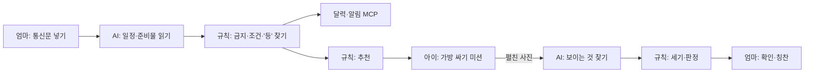

# 가방쏙

> 가정통신문에서 가방까지. 엄마가 넣으면, 아이가 스스로 챙겨요.
>
> 엘리스 AI 챌린지 2026 · 성인 부문 · 팀 잘챙겨조

가정통신문의 준비물은 한 줄 쉼표 나열이고, 조건과 금지는 괄호나 다른 줄에 숨어 있습니다. 가방쏙은 통신문을 넣으면 일정·준비물·가져오지 않는 것을 정리하고, 통신문에 없는 것은 추천으로 따로 채우고, 아이가 미션처럼 스스로 가방을 싸게 합니다. 엄마는 결과를 보고 칭찬 스티커를 붙입니다.

- **대상:** 초등 저학년 아이와 보호자
- **범위:** 통신문 → 달력 → 추천 → 아이 미션 → 칭찬 → 돌아오기. 집 안 수납 찾기와 대화형 도우미는 설계 단계입니다.
- **상태:** 눌러 보는 프로토타입은 예시 판입니다(AI 모델을 부르지 않고 통신문을 규칙으로 읽고, 사진 확인은 준비된 결과). 실제 판(Claude API + MCP)은 코드가 있고 공개 주소에서는 돌리지 않습니다. 사진 확인의 정확도는 아직 재지 않았습니다. [구현 상태](#구현-상태)를 함께 봐 주세요.
- **시연:** [한눈에 보기](https://kimble125.github.io/chaenggyeojwo-ai-bag-check/) · [눌러 보는 프로토타입](https://kimble125.github.io/chaenggyeojwo-ai-bag-check/demo/) (설치·로그인 없음. 통신문과 일정은 지어낸 예시)
- **기획안:** [plan/gabangssok_plan.pdf](plan/gabangssok_plan.pdf) (A4 2쪽)

## 동작 흐름



읽기와 보기는 AI(Claude API)가, 틀리면 곤란한 판단(금지·조건·개수·"다 챙겼지")은 규칙 코드가 합니다. 사진에서 안 보인 것은 '없음'이 아니라 아이가 직접 확인합니다.

## 주요 기능

| 기능 | 내용 |
| --- | --- |
| 통신문 → 일정·준비물·금지 | 행사일과 회신 마감을 따로 일정으로 만들고, 조건("플라스틱 물통")과 '가져오지 않는 것'을 통신문의 그 줄과 함께 보여 줍니다. |
| "등"을 채우는 추천 | 실제 통신문 23건에서 본 준비물, 날씨·미세먼지, 아이 특성으로 추천합니다. 통신문 준비물과 섞지 않고 근거를 붙입니다. |
| 아이 스스로 챙기기 미션 | 펼쳐서 사진 한 번, 안 보인 것만 하나씩. 금지물이 보이면 "이건 두고 가자". 다 넣었을 때만 "다 챙겼지!". |
| 칭찬 스티커 · 돌아오기 | 엄마가 붙인 스티커가 아이 스티커판에 쌓입니다. 집에 오면 다시 가져와야 하는 것만 확인합니다. |
| 내 캘린더에 넣기 | 말투 3가지(보통·귀엽게·또박또박)로 구글 캘린더 링크나 캘린더 파일(.ics)을 만듭니다. 계정 연결이 필요 없습니다. |
| MCP | 캘린더와 가방쏙 규칙을 MCP 도구로 엽니다. AI 비서가 말하고 판단은 규칙 코드가 합니다. |

## 구현 상태

| 부분 | 상태 |
| --- | --- |
| 금지·조건·"등" 찾기, 추천, 세기·판정, 말투 | 구현. 자동 시험 62개(모델·네트워크 없음). 실제 통신문 23건의 문장으로 잼: "등" 11/11, 금지 물건 처음 35/43(잘못 3) → 고친 뒤 43/43(잘못 1, 같은 23건으로 다시 잰 값), 머리말 있는 준비물 줄 19건은 114/114, 머리말 없는 표·학년별 목록 4건은 0/78 ([eval/real-notices-result.md](eval/real-notices-result.md)) |
| 부모 화면, 아이 미션, 스티커, 돌아오기, 이번엔 빼기 | 구현. 공개 주소에서 눌러서 확인(Chromium 계열 1대, 노트북·폰 크기 창). 실제 폰은 미확인 |
| 통신문 읽기 (Claude API) | 실제 판에 구현. 공개 프로토타입은 규칙으로 읽음 |
| 사진 확인 (Claude API) | 실제 판에 구현. 정확도 미측정. 공개 프로토타입은 준비된 결과 |
| 캘린더 MCP 서버 (도구 5개) | 실제 판에 구현. 웹 앱이 MCP 클라이언트로 `add_event`를 불러 일정을 넣음 |
| 가방쏙 MCP 도구 (3개) | 구현. 예시 서버의 `/mcp/`에 Claude Code 2.1.329가 연결되는 것을 확인(✔ Connected), 도구 호출은 JSON-RPC로 직접 확인. 2026-11-22 Claude 데스크톱 앱에 예시 서버를 연결해 `packing_plan`을 불러 답하는 것을 확인(지어낸 예시 통신문 기준). 웹 Claude에서는 연결되지 않음. 실제 판 서버에서의 등록은 미확인 |
| 내 캘린더에 넣기 | 구현. 구글 캘린더는 채워진 화면이 열리는 것을 확인. 캘린더 파일은 형식 시험만 했고 애플·삼성 캘린더 앱에서는 미확인 |
| 날씨·미세먼지 | 구현 (Open-Meteo, 키 없음) |
| 알림 | 앱 안 알림함(전날 19:00, 당일 07:30). 폰 푸시는 미구현 |
| 수납 찾기, 대화형 도우미 | 설계 ([화면 구조도](https://kimble125.github.io/chaenggyeojwo-ai-bag-check/demo/app/design/uiux.html)) |

## 실행

```bash
git clone -b hoyeon https://github.com/kimble125/chaenggyeojwo-ai-bag-check.git
cd chaenggyeojwo-ai-bag-check/poc/donghyun
python3 -m unittest discover -s tests   # 62개, 설치·키 불필요
python3 demo_server.py                  # 예시 판: http://127.0.0.1:6111
```

Python 3.10 이상, 표준 라이브러리만 씁니다.

실제 판은 `ANTHROPIC_API_KEY`가 필요합니다. 키는 커밋하지 않습니다.

```bash
cp .env.example .env    # ANTHROPIC_API_KEY=<키>
docker compose up -d --build   # http://localhost:6110
```

자세한 설정은 [poc/donghyun/README.md](poc/donghyun/README.md)에 있습니다.

## MCP로 쓰기

```bash
claude mcp add --transport http gabangssok http://127.0.0.1:6111/mcp/
# "모레 현장체험학습 뭐 챙겨야 해? 가져가면 안 되는 건?"
```

Claude 데스크톱 앱에도 같은 주소(`http://127.0.0.1:6111/mcp/`)로 붙여 `packing_plan`으로 답하는 것을 확인했습니다(2026-11-22). 웹 Claude에서는 연결되지 않았습니다.

| 도구 | 하는 일 |
| --- | --- |
| `read_notice` | 통신문 글 → 일정, 준비물(조건·수량·입는 것), 가져오지 않는 것과 근거 문장 |
| `packing_plan` | 일정의 챙길 것, 보호자가 정할 것(약), 금지, 추천과 근거, 남은 것 |
| `calendar_entry` | 캘린더에 넣을 제목·메모(말투 3가지)·알림 시각, 구글 캘린더 링크, 캘린더 파일 |
| `add_event` `list_events` `get_checklist` `check_item` `delete_event` | 캘린더 (실제 판 `http://localhost:6110/mcp/`) |

예시 서버는 이 컴퓨터에서 온 요청만 받습니다. `MCP_ACCESS_TOKEN`을 정하면 `Authorization: Bearer <토큰>`을 확인합니다.

## 구조

```
plan/                    2쪽 기획안 (원고 build_plan.py, PDF·Word)
docs/                    공개 페이지 (한눈에 보기 index.html, 프로토타입 demo/)
poc/donghyun/app/        실제 판: FastAPI, 통신문 추출, 캘린더 MCP, 날씨, 알림, 화면
poc/donghyun/app/chaeng/ 규칙 코드: 금지·조건, 추천, 세기·판정, 말투, 캘린더 내보내기, MCP 도구
poc/donghyun/demo_server.py   설치 없이 도는 예시 서버
poc/donghyun/build_site.py    같은 화면과 규칙 코드를 브라우저 안(Pyodide)에서 돌리는 판을 만듦
poc/donghyun/tests/      자동 시험
```

## 데이터와 개인정보

- 아이는 AI와 직접 대화하지 않습니다. 화면의 말은 코드에 적어 둔 문장입니다.
- 약과 "필요한 학생만" 준비물은 아이 화면에 나오지 않고 보호자가 정합니다.
- 사진은 저장하지 않고 확인할 때만 AI로 보냅니다. 통신문은 뽑아낸 일정·준비물과 근거 줄만 남깁니다.
- 로그인이 없고 아이의 위치를 쓰지 않습니다. 날씨는 정해 둔 동네의 예보입니다.
- 공개 프로토타입은 넣은 글과 사진을 어디로도 보내지 않습니다. 바깥과 주고받는 것은 실행 도구·글꼴 내려받기와 날씨 조회뿐입니다.

## 팀

김호연 (기획, 서비스 설계, 규칙·추천, 아이 화면), 김동현 (개발·배포, 통신문 추출, 캘린더 MCP, 날씨·알림)

## 외부 자원

| 이름 | 용도 |
| --- | --- |
| Anthropic Claude API (`claude-opus-5-5`) | 통신문 읽기, 사진에서 보이는 것 찾기 (실제 판) |
| MCP Python SDK, FastAPI, SQLite | 실제 판 서버와 캘린더 MCP |
| Open-Meteo | 날씨·미세먼지 예보 |
| Pyodide 0.26.4 (jsDelivr) | 공개 프로토타입에서 규칙 코드를 브라우저 안에서 실행 |
| Jua, Noto Sans KR (Google Fonts) | 글꼴 |
| 초등학교 홈페이지의 가정통신문 23건 | 추천 데이터의 원천. 준비물 이름과 빈도, 출처 주소와 한 줄 인용을 `poc/donghyun/app/chaeng/scenarios.json`에 둠 |
| 이미지 생성 AI | 마스코트 쏙이 그림 |
| Claude, GPT | 조사, 초안, 코드, 검토 (결과는 팀이 확인하고 고침) |

숫자와 인용의 출처는 [한눈에 보기](https://kimble125.github.io/chaenggyeojwo-ai-bag-check/)와 기획안에 있습니다. 대회 조건과 작업 기록은 `docs/`에 있습니다.
